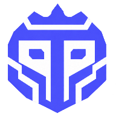

# TopBot Iteration Lab

This separate repository rehearses TopBot releases using public source and synthetic fixtures. Do not install its releases on a real profile. The actual project is [TopBot](https://github.com/topway-ai/TopBot).



# TopBot

A local-first desktop application for chatting with AI agents and using tools.

## This Fork

- Repository: https://github.com/topway-ai/TopBot-Iteration-Lab
- Product name: TopBot.
- The desktop and in-app icons use the TopWay-inspired TopBot identity.
- Upstream promotional popups, sponsor placements, mailing-list invitations and advertisement downloads are removed from the desktop experience.
- Updates are built and installed explicitly; upstream automatic updates are disabled.
- Existing model connections, conversations and approval settings are preserved.

## Development

Requires Node.js 24 or newer and the package manager declared in package.json.

```sh
pnpm install --frozen-lockfile
pnpm dev
```

Icon assets are generated from the approved artwork in `build/topbot-logo-source.png`.
Run `pnpm build:icons` to rebuild Windows, macOS, Linux and web icon assets.
The original horizontal logo is available at `public/topbot-logo.png`.

Read [AGENTS.md](AGENTS.md), [DESIGN.md](DESIGN.md), and the
[verification guide](docs/verification/README.md) before changing the application.
Use an isolated fixture for tests, never the installed user's workspace.

## Compatibility

The existing `~/.openmausbot` data directory, Windows `AppData/Roaming/openmausbot`
profile, `OMB_*` environment variables, IPC names, URL schemes and package formats
are intentionally retained. These are compatibility identifiers, not display branding.
The original names remain in required license and third-party notices.

Existing external cloud accounts can still be managed. TopBot does not operate
or advertise an upstream cloud service under its own name.

## License And Attribution

Derived from [OpenMausBot](https://github.com/milind-soni/OpenMausBot).
[Apache License 2.0](LICENSE), copyright 2026 Milind Soni and OpenMausBot contributors,
except `enterprise/`, which has its [own license](enterprise/LICENSE) and is
excluded from this desktop build. See [NOTICE](NOTICE) and [LICENSING.md](LICENSING.md).

Bundled native components retain their original licenses and attribution.
See [third_party/cua-driver](third_party/cua-driver/) and the licenses shipped
with the desktop application.
